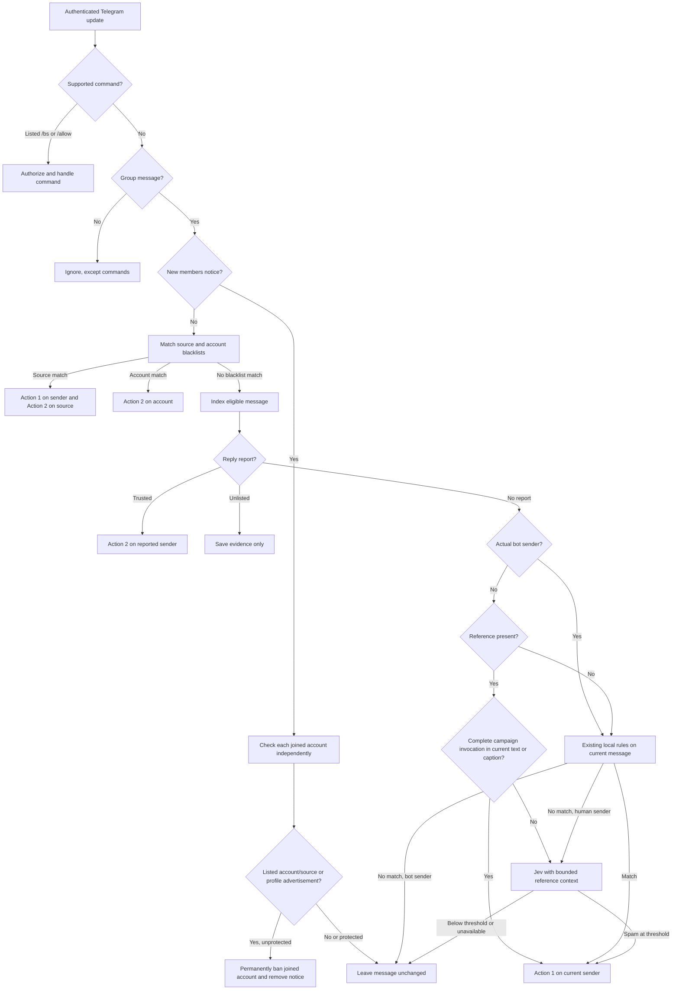
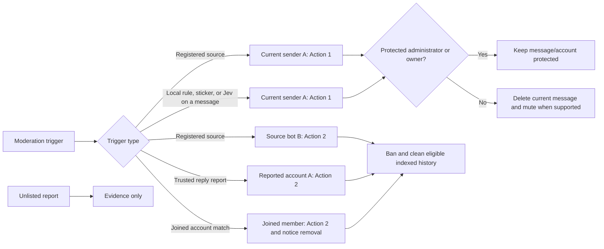

# Message processing and reporting

This is the bot's stable behavior contract. It describes what Telegram users and trusted operators can expect from an authenticated update. Deployment steps belong in [setup](setup.md); routine operations belong in [operations](operations.md); development and extension guidance belongs in [CONTRIBUTING.md](../CONTRIBUTING.md).

## Scope and authorization

The Worker accepts authenticated Telegram `message` and `edited_message` updates at `POST /webhook`. Invalid content is rejected without moderation. Private messages are ignored except for supported commands.

A reporting identity is either a configured user ID or a configured sender-chat ID. A sender-chat identity is evaluated on its own; a compatibility `from` field cannot authorize it. An ordinary user must be a genuine non-bot sender whose ID is configured. Authorization is checked again on redelivery and retry.

- A listed `/bs` command is handled before automatic filtering. `/bs @username` registers the named source without immediately moderating a reply target. A bare `/bs` reply registers the target's inline bot, or its actual bot sender when there is no inline bot; registration must succeed before the target and registered source receive Action 2. The guest caller is not a source or moderation target. Sticker registration and target validation still apply.
- A listed `/allow @username` or `/allow <account ID>` in a supergroup removes the selected account from this bot's account blacklist and the shared source blacklist, then permits it to rejoin that supergroup. Telegram unban confirmation precedes blacklist removal. Existing members, restrictions, other groups' bans, other bots' account entries, and sticker lists are unchanged. Recorded usernames are checked against the account's current profile before first resolution, then stay pinned on retry; unresolved, renamed or ambiguous identities require the numeric ID. `/allow` uses the same configured reporting identities as `/bs`, not administrator status alone; edited, private-chat and basic-group forms do not change state.
- An unlisted bare `/bs` reply to a valid group target records evidence but does not register a source or punish an account.
- An unlisted reply that mentions the bot records evidence and ends routing.
- An explicit unlisted `/bs` argument continues through ordinary filtering instead of registering a source.
- A report target must be a valid message in the same group; a forum topic's creation message is not a target.

## Routing order

For a new group message, processing follows this order:

1. Validate the update and authenticated webhook request.
2. Dispatch authorized commands before automatic filtering.
3. Route a join notice to independent checks of its new members, rather than its inviter.
4. For other messages, match explicit source identities and account blacklists.
5. Index an eligible message for possible later history cleanup, then apply reply reports and remaining command handling.
6. Apply local text, profile, sticker, and maintenance rules to messages without a reference and to actual bot senders even when referenced. For referenced human messages, apply only the complete authored campaign-invocation check.
7. Queue Jev classification for the remaining eligible input.
8. Leave the message unchanged when no rule or model decision reaches the configured threshold.

Human messages with a same-chat reply, external reply, or quote bypass general local regex and sticker-list checks so Jev can interpret their context.

The exception is a complete invocation in the current text or caption: after trimming whitespace, `@username campaign_<digits>` with one optional argument made of ASCII letters, digits or underscores triggers Action 1 without requiring Jev. Usernames contain 5–32 ASCII letters, digits or underscores; campaign digits are ASCII and separators are whitespace. This exception does not read nicknames, biographies, referenced text or guest caller metadata. Bare mentions, explanatory prose, warnings and reports do not match the complete-invocation check; existing report routing still takes precedence. It neither registers the named bot as a source nor punishes any referenced author or caller.

Actual bot senders, including guest bots, still undergo the existing local checks on their own message even when replying; they do not enter Jev. Referenced content and guest caller metadata never substitute for the current sender's content or identity. A forum topic attachment that is not an explicit reply does not count as a reference.

## Moderation decision map

The two moderation actions have different targets. Source identities include the actual bot sender, an inline bot, and visible forwarded bot origins; a compatibility `from` attached to `sender_chat` and guest caller metadata are never source identities. A source match handles the sender and each listed source independently. When a direct bot is both sender and source, Action 2 targets that same bot, not its caller. A trusted report handles the explicitly reported account; an automatic content match handles only the current sender.

## Moderation outcomes

### Action 1: remove the current message and mute its sender

Local rules, sticker matches, and Jev spam matches use Action 1. The bot removes only the triggering message and permanently restricts a human sender when Telegram supports that operation. It does not clean history or add a blacklist entry. Bots are not muted. Basic groups support deletion but not permanent mute.

Group owners, administrators, and messages sent as a group's anonymous identity are protected from automatic Action 1. A valid trusted report may still delete an explicitly reported administrator message.

### Action 2: ban an account and clean eligible history

Trusted reply reports, explicit source reports, and matching joined accounts use Action 2. The bot bans the selected account when allowed, prevents rejoining, and removes eligible indexed messages in that group. A reported target message is deleted independently of the ban result when Telegram permits it. Confirmed bans add the account to the bot-scoped account blacklist.

Action 2 never treats the source bot as the sender's history unless the command explicitly reports both accounts. Target administrators remain protected from automatic bans and history cleanup.

## Joining accounts

A new `new_chat_members` service notice in a supergroup checks each joined account independently. The inviter or service-message actor is neither classified nor indexed as a joiner. Duplicate member identities are processed once; the moderation bot itself is skipped. Edited join notices and other service events do not create join checks.

Existing account blacklists and registered bot sources apply to joined accounts even before they speak. Otherwise, the bot checks a human joiner's own bounded nickname and available biography against existing profile-safe local rules and, when configured, a separate Jev profile-advertising scope. A nickname or biography that clearly solicits services, goods, sexual offers, cryptocurrency trades, or recruitment can be sufficient without an authored message. Isolated keywords, emoji, student identities, ordinary self-description, warnings, fictional dialogue, or advertisements in linked targets alone are insufficient. Unknown profile fields are not evidence of spam. Unlisted bots do not enter profile classification.

A match permanently bans only that joined account, preventing rejoining, and records the confirmed ban in the existing bot-scoped account blacklist. It also removes the shared join notice and cleans eligible indexed history of that account, not the inviter. Normal co-joiners stay in the group; administrators and owners remain protected. A confirmed ban is not repeated when notice deletion needs retry. Each member has an independent durable task and moderation subject, so one failed lookup, decision, or action does not overwrite another's progress.

## Local filtering

Local checks run before Jev on messages without a reference and on actual bot senders with references. General local patterns inspect authored text, captions, shared contact display names, and sender nicknames; deferred profile checks inspect the available sender and contact-account biographies after Telegram lookups. A separate maintenance pattern checks only current text and captions for a same-sentence claim that a group or channel is disabled, moved, or replaced followed by a request to join a new destination. Administrators are protected before Action 1, so ordinary administrator notices remain intact.

A local match ends model classification for that message. The same local regex and sticker checks apply to new and edited bot messages regardless of a reference; human reference messages keep the Jev path. Floods found only in referenced content do not count as a local match. Bots receive deletion only for a content match, while administrator/anonymous-group protection still applies. A registered source match uses Action 2 on the bot separately from content filtering.

## Jev classification

Jev is optional. When enabled, the bot sends the current sender's bounded message context, selected profile data, contact display data, and bounded reference context to the configured provider. It does not download or inspect media. Provider failures are retried according to the durable task policy; invalid or unavailable model answers do not count as spam.

The current sender's intent is the primary evidence. Reference content and profile data remain source-separated. A referenced advertisement alone does not punish the current sender; endorsement, contact, join, order, or similar promotion can. Supplying only a recruitment contact in the current message can complete the contact funnel of a clearly advertising reference without an explicit recommendation verb. Isolated handles and contacts for ordinary job information are insufficient. Warnings, reports, analysis, verification, sample requests, ordinary discussion, personal experience, and personal support are not promotion, including when they identify an advertised contact.

Product/service pitches, private-group recruitment, public-group/channel recruitment, project recruitment, payment-code recruitment, sexual offers, income recruitment, and cryptocurrency solicitation are evaluated by their respective semantic conditions. Cross-border group-branded recruitment combining generalized promotion/merchant-acquisition roles, U-denominated bonuses or base pay, high commissions, and high combined earnings can constitute recruitment advertising without proof of fraud or daily-income promises. Ordinary local jobs, concrete overseas employment, and salary discussion are not classified by country, pay amount, currency, or job title alone. A product's features or warranty can form a short sales pitch; isolated keywords, profile text, links, coin names, payment terms, or quoted advertisements do not independently establish spam.

The inclusive score threshold is the `SPAM_THRESHOLD` value maintained in `src/anti_fwd_spam/constants.py`. A message score at or above it uses Action 1; the separate joining-account scope uses the join outcome above. A lower score, invalid answer, missing provider, or failed request leaves the message visible.

## Edits and retries

An edit fences older model work for that message. An edited message still passes source and report routing. An edited human message without a reference can use local rules; an eligible referenced human edit starts fresh Jev classification. Bot messages use local rules even when referenced and never enter Jev. Edits do not rerun automatic account-blacklist checks.

Webhook delivery retries and scheduled task retries are separate. Durable task leases prevent concurrent work from repeating a completed moderation action. A confirmed deletion or ban is not repeated after a later redelivery; uncertain operations remain retryable or require manual inspection.

Within retained evidence, `/allow` fences older source registration and moderation events and cancels superseded account tasks. Completed command redelivery does not undo a subsequent new ban. This is replay protection, not a permanent allowlist: a new advertisement, join, or trusted report can trigger moderation again. Already-issued Telegram requests require outcome handling; unresolved overlap requires manual inspection rather than silently claiming recovery. Deleting blacklist rows does not restore deleted history or unmute a restricted current member.

## Stored state and privacy

The bot stores report evidence, moderation progress, bounded pending model input, message identifiers, and long-lived source/account/sticker blacklists in D1. Recent-message indexes contain identifiers and timestamps rather than message text. Pending model content is cleared after classification finishes. Retention and cleanup are implementation-owned; operators should keep database exports and member information private.
