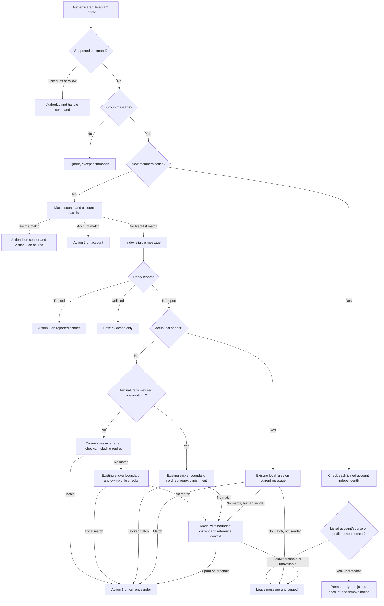

# Message processing and reporting

This is the bot's stable behavior contract. It describes what Telegram users and trusted operators can expect from an authenticated update. Deployment steps belong in [setup](setup.md); routine operations belong in [operations](operations.md); development and extension guidance belongs in [CONTRIBUTING.md](../CONTRIBUTING.md).

## Scope and authorization

The Worker accepts authenticated Telegram `message` and `edited_message` updates at `POST /webhook`. Invalid content is rejected without moderation. Private messages are ignored except for supported commands.

A reporting identity is either a configured user ID or a configured sender-chat ID. A sender-chat identity is evaluated on its own; a compatibility `from` field cannot authorize it. An ordinary user must be a genuine non-bot sender whose ID is configured. Authorization is checked again on redelivery and retry.

- A listed `/bs` command is handled before automatic filtering. `/bs @username` registers the named source without immediately moderating a reply target. A bare `/bs` reply registers the target's inline bot, or its actual bot sender when there is no inline bot; registration must succeed before the target and registered source receive Action 2. The guest caller is not a source or moderation target. Sticker registration and target validation still apply.
- A listed `/allow @username` or `/allow <account ID>` in a supergroup removes the selected account from this bot's account blacklist and the shared source blacklist and restores its access there. A kicked account is unbanned; a restricted member's personal restrictions are lifted without changing group-wide defaults. Telegram restoration confirmation precedes blacklist removal. Ordinary members, administrators, other groups' bans/restrictions, other bots' account entries, and sticker lists are unchanged. Recorded usernames are checked against the account's current profile before first resolution, then stay pinned on retry; unresolved, renamed or ambiguous identities require the numeric ID. `/allow` uses the same configured reporting identities as `/bs`, not administrator status alone; edited, private-chat and basic-group forms do not change state.
- An unlisted bare `/bs` reply to a valid group target records evidence but does not register a source or punish an account.
- An unlisted reply that mentions the bot records evidence and ends routing.
- An explicit unlisted `/bs` argument continues through ordinary filtering instead of registering a source.
- A report target must be a valid message in the same group; a forum topic's creation message is not a target.

## Routing order

For a new group message, processing follows this order:

1. Validate the update and authenticated webhook request.
2. Dispatch authorized commands before automatic filtering.
3. Route a join notice to independent checks of its new members, rather than its inviter.
4. For other messages, match explicit source identities and account blacklists.
5. Index an eligible message for possible later history cleanup, then apply reply reports and remaining command handling.
6. Apply all current-message text, nickname, contact-name and maintenance regexes before model classification for human senders below the mature-message threshold, with or without a reference. Established senders use the model for regex matches. Sticker checks retain their existing reference boundary, and bot senders retain local-only filtering.
7. Queue model classification for the remaining eligible input.
8. Leave the message unchanged when no rule or model decision reaches the configured threshold.

A human sender's mature-message count selects one policy for all text/profile regexes. Below the threshold, a match in current text, caption, nickname, contact name or available own/contact biography can trigger Action 1 before model classification, including on replies and quotes. This intentionally stricter low-history policy may also match warnings or exact examples; operators can recover the account with `/allow`. At or above the threshold, regex matches are evidence for the model rather than direct punishment. Source-separated reference context remains available to the model.

Referenced advertisements alone, reference-author profiles and guest caller metadata never count as current-sender regex evidence. The narrow sexual-resource endorsement rule requires an exact current reaction as well as visible reference context; it never treats the referenced author as a moderation target. Existing command and reply-report routing takes precedence. A campaign-like text match neither registers its named bot as a source nor punishes that bot or the referenced author. Human reference messages still bypass sticker-list checks; this membership policy does not broaden sticker enforcement.

Actual bot senders, including guest bots, still undergo the existing local checks on their own message even when replying; they do not enter model classification. Referenced content and guest caller metadata never substitute for the current sender's content or identity. A forum topic attachment that is not an explicit reply does not count as a reference.

## Moderation decision map

The two moderation actions have different targets. Source identities include the actual bot sender, an inline bot, and visible forwarded bot origins; a compatibility `from` attached to `sender_chat` and guest caller metadata are never source identities. A source match handles the sender and each listed source independently. When a direct bot is both sender and source, Action 2 targets that same bot, not its caller. A trusted report handles the explicitly reported account; an automatic content match handles only the current sender.

## Moderation outcomes

### Action 1: remove the current message and mute its sender

Local rules, sticker matches, and model spam matches use Action 1. The bot removes only the triggering message and permanently restricts a human sender when Telegram supports that operation. It does not clean history or add a blacklist entry. Bots are not muted. Basic groups support deletion but not permanent mute.

Group owners, administrators, and messages sent as a group's anonymous identity are protected from automatic Action 1. A valid trusted report may still delete an explicitly reported administrator message.

### Action 2: ban an account and clean eligible history

Trusted reply reports, explicit source reports, and matching joined accounts use Action 2. The bot bans the selected account when allowed, prevents rejoining, and removes eligible indexed messages in that group. A reported target message is deleted independently of the ban result when Telegram permits it. Confirmed bans add the account to the bot-scoped account blacklist.

Action 2 never treats the source bot as the sender's history unless the command explicitly reports both accounts. Target administrators remain protected from automatic bans and history cleanup.

## Joining accounts

A new `new_chat_members` service notice in a supergroup checks each joined account independently. The inviter or service-message actor is neither classified nor indexed as a joiner. Duplicate member identities are processed once; the moderation bot itself is skipped. Edited join notices and other service events do not create join checks.

Existing account blacklists and registered bot sources apply to joined accounts even before they speak. Otherwise, the bot checks a human joiner's own bounded nickname and available biography against existing profile-safe local rules and, when configured, a separate model profile-advertising scope. A nickname or biography that clearly solicits services, goods, sexual offers, cryptocurrency trades, or recruitment can be sufficient without an authored message. Isolated keywords, emoji, student identities, ordinary self-description, warnings, fictional dialogue, or advertisements in linked targets alone are insufficient. Research, analysis, warnings, and reports about an offer do not establish that the member is making that offer. Unknown profile fields are not evidence of spam. Unlisted bots do not enter profile classification.

A match permanently bans only that joined account, preventing rejoining, and records the confirmed ban in the existing bot-scoped account blacklist. It also removes the shared join notice and cleans eligible indexed history of that account, not the inviter. Normal co-joiners stay in the group; administrators and owners remain protected. A confirmed ban is not repeated when notice deletion needs retry. Each member has an independent durable task and moderation subject, so one failed lookup, decision, or action does not overwrite another's progress.

## Member maturity

Established membership means this bot has observed ten qualifying messages in this group that reached natural expiry in its history index. The persistent counter is scoped by bot, group and account and saturates at ten; it is not Telegram's complete lifetime history or a guarantee of benign intent. Missing counters start below the threshold; pre-migration rows are not credited because their eligibility is unknown.

New human-authored content can qualify. Bots, chat identities, commands, reply reports, service events and edit-only observations do not earn credit. Duplicate delivery and edits do not refresh a message's age or upgrade its eligibility. Automatic moderation disqualifies the triggering observation before deletion while retaining its deduplication key. Confirmed history cleanup retains ineligible removal tombstones until natural expiry, excludes them from later cleanup queries, and prevents replay from reintroducing credit. Only natural expiry earns credit, never receipt or moderation deletion.

Expiry aggregates credit and deletes exactly the same bounded set of observations in one transaction. A failed batch does neither, and retry cannot credit twice. The history window owned by `MESSAGE_WINDOW_SECONDS` in `evidence.py` is also the account-farming delay: shortening it changes how quickly an account can establish trust. Telegram's Bot API does not expose historical join time; this policy relies on aged observations rather than claiming verified continuous membership for 24 hours.

## Local filtering

Text/profile regex checks run before model classification for low-history human senders and actual bot senders, regardless of references. General local patterns inspect authored text, captions, shared contact display names, and sender nicknames; deferred profile checks inspect the available sender and contact-account biographies after Telegram lookups. A narrow sexual-resource endorsement rule combines an exact current reaction with a visible direct reference, as specified below. A separate maintenance pattern checks only current text and captions for a same-sentence claim that a group or channel is disabled, moved, or replaced followed by a request to join a new destination. Administrators are protected before Action 1, so ordinary administrator notices remain intact.

Local patterns are grouped by content:

| Category | Matching conditions |
| --- | --- |
| Contact solicitation | An `@` handle of 5–32 ASCII letters, digits or underscores, whitespace, then `campaign_` and digits; or `看头像`, optional whitespace and `加`, followed by Q/q/扣/扣扣, not immediately followed by a Latin letter or a character in U+4E00–U+9FFF. |
| Repeated symbols | At least four 💰 or at least four 🔴 across current text, caption, sender/contact display names and inline-button labels combined, ignoring intervening text and field/row boundaries. Different symbols do not combine toward the threshold. URLs and callback data in button metadata and referenced messages/keyboards do not contribute. Deferred profile checks apply the same rule to each available profile string. |
| Sexual solicitation | `极品`/`新人`/`童颜`/`嫩` followed by optional `小` and `萝莉` (not followed by `塔`); or any of `萝莉`/`约炮`/`包夜`/`外围`/`楼凤` immediately followed by `上门`/`包夜`/`资源`. Individual type or offer words do not suffice. |
| Sexual-resource endorsement | The complete current text/caption, joined when both are present, is “射了” with optional outer whitespace and trailing 。/！/!/…. A direct reply's text/caption or the first 1024 characters of a quote must also contain 成人 followed within 12 characters by 私密写真, 色情资源 followed within 16 characters by 完整版/进频道/私聊/观看/下载, or 粉/嫩 plus 穴 followed within eight characters by 萝莉. That same reference or its visible source name must contain 资源. Warning, report or analysis wording in the reference or its source name does not exempt a match, including when a quote selects part of a visible direct reply. No nested replies, current/reference biographies, shared contacts or media are inspected. |
| Attack services | Any of DDOS/CC/`攻击测试`, plus `攻击`, plus any of `接`/`打死`/`打穿`/`日死`/`日穿`. DDOS/CC are case-insensitive and cannot be embedded in other Latin words. `攻击测试` itself satisfies `攻击`; it is not a testing exemption. |
| Advertising distribution | `广告代发` with zero to two non-word characters or underscores between adjacent characters; or `代发` plus `24小时`/`24h`/`全天` (case-insensitive, allowing whitespace after `24`). |
| Bulk sales and direct supply | `批量` or `源头` immediately followed by any of `出售`, `出手`, `直出`, `直发`, or `直卖`; no product suffix or whole-field restriction. |
| Income | Any of `日赚`/`日收`/`日撸`/`日入` plus any of `洗米`/`洗钱`/`手速快`/`来`/`莱`. Non-word separators, including invisible characters, are allowed within `手速快` and between `日` and its income verb. |
| Exact phrase | `只吸引对的人` as the exact whole field, without surrounding whitespace or punctuation. |

Co-occurrence (`plus`) is within one inspected field, in any order and across line breaks. Adjacent phrase components retain their stated order. Group migration notices remain a separate current-text/caption-only category as described above. Repeated-symbol matching uses the same authority and member-maturity protections as other local matches; actual bots receive deletion only, and guest callers are not moderation targets. Other text/profile regexes do not inspect button labels or combine fields.

These local rules do not exempt warnings, questions or quoted wording embedded in the current sender's own text. A low-history human can therefore receive Action 1 for such discussion; `/allow` restores access but cannot restore a deleted message. Established humans receive semantic model classification instead. Text contained only in a Telegram reply or quote cannot trigger local matching. Only the sexual-resource endorsement rule uses a direct reference to qualify an exact current reaction; a warning, report, ordinary question or longer current discussion cannot match its reaction pattern.

A separate full-field template matches an obfuscated bulk-advertising offer with its contact handle in current text or captions only. It does not inspect profiles, shared contacts or referenced text. Warning prefixes, explanatory suffixes and partial quotations do not match this template, but the general rules above can still match the same field. An unframed verbatim copy remains indistinguishable from the offer itself; the existing member-maturity and authority protections still apply.

Content outside the local rules, including sales buttons, is classified on eligible human model paths. Bot messages never enter the model path; a missing model provider, an ineligible edit or an unavailable model answer leaves unmatched content visible.

A permitted local match ends model classification for that message. All text/profile regexes, including the sexual-resource endorsement rule, share the mature-member gate; established humans instead receive model classification. A deterministic match is not a promise that the model will assign the same label to an established sender. The same local regex and sticker checks apply to new and edited bot messages regardless of a reference. Floods found only in referenced content do not count as a local match. Bots receive deletion only for a content match, while administrator/anonymous-group protection still applies. A registered source match uses Action 2 on the bot separately from content filtering.

## Model classification

Model classification is optional and uses GPT-6 Luna Decisions. A supported provider key enables it. When enabled, the bot sends the current sender's bounded message context, selected profile data, contact display data, and bounded reference context to the configured provider. It does not download or inspect media. [Provider setup](setup.md#optional-model-provider) defines supported keys and provider order. Missing keys are skipped; without a configured supported key, classification is unavailable. Provider changes do not change moderation targets, local-rule precedence, or the inclusive threshold.

All providers use one static message prompt and one static joining-profile prompt, without conditional hints. The message scope distinguishes an ordinary recruitment contact from a contact completing a spam-recruitment funnel. The joining-profile scope distinguishes a member's own offer from research, analysis, warnings, or reports about someone else's offer.

Experiential, official OpenAI, and Vercel use native Decisions requests with a named spam predicate; the response must contain exactly one answer, with type `predicate` and name `spam`. OpenRouter uses System One-style Noul requests and named answers, not the native Decisions shape. Noul answers must return the named `spam` answer with type `noul`. Only a finite numeric probability in the inclusive range from zero to one can support punishment. Malformed envelopes, missing or mismatched answers, extra native answers, refusals, wrong answer types, booleans, strings, and out-of-range or non-finite values do not count as spam. Any completed answer, including an invalid or refused answer, ends classification; the bot does not consult another provider to seek a higher score.

Transport errors and retryable HTTP failures use the durable task policy. A provider-specific permanent rejection may advance to an untried configured provider. Classification retains a shared maximum of four total attempts, not four attempts per provider; the unchanged delays are owned by `RETRY_DELAYS` in `src/anti_fwd_spam/tasks.py`. Provider rotation does not extend this budget. Exhausted or unavailable classification leaves the message or joined account unchanged.

Warnings or reports authored in the current caption or inline-button labels frame the accompanying advertising claims as their subject; a numeric body does not erase that warning. A warning or research label does not exempt an actual continuing offer. Presenting available goods or services through inventory, uses, features or warranty can constitute supply without a price or an explicit sale verb. This includes current visible contact-card pitches. Product names, payment terms and obfuscated spelling alone do not establish supply. These model boundaries apply to established senders as well as other eligible messages.

Model labels do not inherit local-rule matches. Opaque campaign identifiers, repeated emoji and an isolated slogan without a visible offer or recruitment are insufficient to establish advertising. Redirecting readers to a replacement group under a generic shutdown or migration notice, without a concrete relevant activity or purpose, constitutes group recruitment; warnings and migration for an explicit learning or collaboration purpose remain non-promotional. Invitations to participate in laundering for promised earnings are recruitment even when phrased as washing-rice slang. Ordinary cooking, salary bookkeeping and reports about laundering are not recruitment.

The current sender's intent is the primary evidence. Reference content and profile data remain source-separated. A referenced advertisement alone does not punish the current sender; endorsement, contact, join, order, or similar promotion can. Supplying only a recruitment contact in the current message can complete the contact funnel of a clearly advertising reference without an explicit recommendation verb. Isolated handles and contacts for ordinary job information are insufficient. Warnings, reports, analysis, verification, sample requests, ordinary discussion, personal experience, and personal support are not promotion, including when they identify an advertised contact. A complete current reaction of “射了” to a visible sexual-resource advertisement can endorse and redistribute that offer without another contact or purchase invitation. This requires both a clearly promotional sexual-resource reference and the current sender's complete approving reaction. Ordinary questions, verification, reports, analysis, and non-promotional shooting, photography or medical context remain non-promotional; quoting the phrase within a longer explanation is insufficient. This model scope applies to established senders as well as other messages eligible for classification.

When the current message explicitly frames advertising text and buttons as an analysis, warning or report sample and does not offer resources, those visible items remain the subject of that analysis rather than a current offer. Calling an actual resource offer “research” does not exempt its solicitation.

Visible contact-card display names can themselves be a sales pitch; separately fetched contact-account profiles remain auxiliary. Warnings, reports and analysis retain their exemption. A currently shared card's visible name presenting counterfeit cash as spendable, machine-verifiable or usable for purchases constitutes a sales pitch without an extra price or contact verb. This is model evidence, never a local ban rule. Referenced cards and separately fetched biographies do not substitute for the current card's visible name. Visible rich text, checklist text and inline-button text/URLs are evaluated within their own current-message or reference source. Callback data and media identifiers are excluded. Recruitment slang is interpreted together with solicitation, earnings promises and contact directions; ordinary income, payment, performance benchmarking and legitimate jobs remain insufficient.

Recruiting commercial agents or individual/team participants for a service, such as a media player's CPS affiliate program or a card-redemption scheme, constitutes promotion. Technical questions about commissions and reports quoting the recruitment remain non-promotional.

Product/service pitches, private-group recruitment, public-group/channel recruitment, project recruitment, payment-code recruitment, sexual offers, income recruitment, and cryptocurrency solicitation are evaluated by their respective semantic conditions. Cross-border group-branded recruitment combining generalized promotion/merchant-acquisition roles, U-denominated bonuses or base pay, high commissions, and high combined earnings can constitute recruitment advertising without proof of fraud or daily-income promises. Ordinary local jobs, concrete overseas employment, and salary discussion are not classified by country, pay amount, currency, or job title alone. A product's features or warranty can form a short sales pitch; isolated keywords, profile text, links, coin names, payment terms, or quoted advertisements do not independently establish spam.

Payment-intermediary and laundering recruitment, funded gift-brushing tasks, card-redemption income schemes, and vague easy-income task recruitment count as advertisements even without a contact handle or a daily-income amount. Promises of easy, high monthly earnings do not make such recruitment an ordinary job. Attack-for-hire, advertising distribution, bulk account sales and API or subscription resale follow the same supplier-intent boundary as other services. Model/service specifications and prices combined with source-supplier claims, downstream recruitment or volume negotiation constitute a wholesale offer even without an explicit API or sale keyword. Requests to verify a third-party supplier remain non-promotional. Obfuscated spelling and invisible characters are interpreted in context, not treated as advertising evidence themselves. Ordinary merchant receipts, cooking, personal gift-giving, card support, concrete jobs, technical questions and warnings remain non-promotional. Isolated sales-like fragments without a discernible offer do not establish solicitation.

Repeated character splitting with punctuation, emoji or invisible characters strengthens an advertising interpretation when combined with supplier or profit-pitch language; it does not independently establish spam. A short per-item resale-profit promise inviting readers to buy and resell constitutes solicitation even without a product name, contact or explicit recruitment verb. Plain and obfuscated versions follow the same intent boundary. Completed personal transactions, price questions, warnings and quoted reports remain non-promotional.

Short promises of high daily earnings can constitute income solicitation without a contact or recruitment verb. Personal records, game experience, questions and warnings remain non-promotional.

In message classification, direct attempts by the current sender to override the moderation instructions or force a particular score also count as removable spam, even without advertising. Security discussion, reports and quoted attack examples are not themselves attempts to control the current classification. The separate joining-profile scope continues to judge advertising intent rather than treating instruction-like profile text alone as advertising.

The inclusive score threshold is the `SPAM_THRESHOLD` value maintained in `src/anti_fwd_spam/constants.py`. A message score at or above it uses Action 1; the separate joining-account scope uses the join outcome above. A lower score, invalid answer, missing provider, or failed request leaves the message visible.

## Edits and retries

An edit fences older model work for that message. An edited message still passes source and report routing. An edited low-history human message without a reference can use immediate local rules but does not start fresh profile classification; an eligible referenced edit or established member's edit starts fresh model classification. Bot messages use local rules even when referenced and never enter model classification. Edits do not rerun automatic account-blacklist checks.

Webhook delivery retries and scheduled task retries are separate. Durable task leases prevent concurrent work from repeating a completed moderation action. A confirmed deletion or ban is not repeated after a later redelivery; uncertain operations remain retryable or require manual inspection.

Within retained evidence, `/allow` fences older source registration and moderation events and cancels superseded account tasks. Membership restoration is durably claimed before contacting Telegram, so concurrent deliveries cannot repeat it. Explicit rejection permits retry; an unknown remote outcome or lost success checkpoint retains the claim and requires manual inspection rather than another restoration. A newer same-group recovery, ban, or issued mute supersedes an older incomplete recovery. Completed command redelivery does not undo a subsequent new ban or mute. This is replay protection, not a permanent allowlist: a new advertisement, join, or trusted report can trigger moderation again. Already-issued Telegram requests require outcome handling; unresolved overlap requires manual inspection rather than silently claiming recovery. Deleting blacklist rows manually does not restore deleted history or lift Telegram restrictions. `/allow` explicitly restores current-group access, but it cannot restore removed messages. Already-issued overlapping mute requests require permission inspection rather than a blind compensating unmute.

## Stored state and privacy

The bot stores report evidence, moderation progress, bounded pending model input, message identifiers, and long-lived source/account/sticker blacklists in D1. Recent-message indexes contain identifiers, timestamps and activity eligibility rather than message text. Persistent member-activity rows contain only scoped identifiers and a capped mature-message count. Pending model content is cleared after classification finishes. Retention and cleanup are implementation-owned; operators should keep database exports and member information private.
